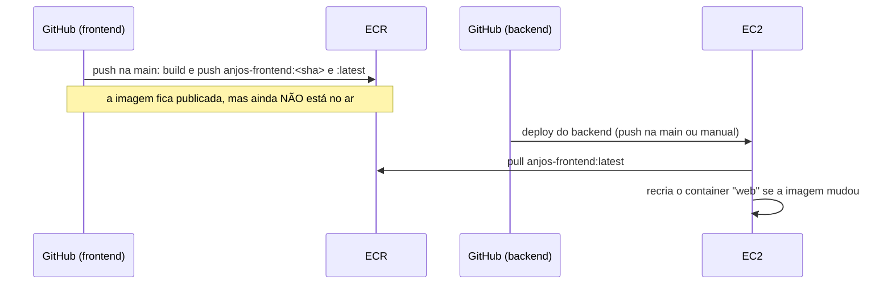

# Deploy do frontend

Como o frontend do Anjos Protetores vira uma imagem Docker, como ela é testada e como chega
ao servidor em **https://abrigoanjosprotetores.com.br**.

> A infraestrutura da AWS e o deploy no servidor ficam no repositório do **backend**
> (`infra/` e `docs/deploy-aws.md`). Este repositório só gera e publica a imagem.

## Onde o frontend entra na arquitetura

```
Internet ──HTTPS──► Caddy (no servidor) ──"/"──────► web: este container (nginx, porta 8080)
                                       └─"/api/*"──► api: backend (porta 4000)
```

- O **Caddy** cuida do HTTPS. Este container fala só HTTP simples, na porta 8080, e nunca
  fica exposto direto à internet.
- Site e API ficam no **mesmo domínio**. Por isso o frontend chama a API pelo caminho
  relativo `/api` (sem CORS e sem endereço fixo de servidor no código).

## Como a imagem é construída

O `Dockerfile` tem duas etapas:

| Etapa | Base | O que faz |
|---|---|---|
| `build` | `node:24.22.1-bookworm-slim` | `npm ci` + `npm run build` (checagem de tipos com `tsc` e build do Vite) → pasta `dist/` |
| `final` | `nginxinc/nginx-unprivileged:1.30.6-alpine` | Só o nginx com o `dist/`. Sem Node, sem código-fonte, sem `node_modules` |

A imagem final roda como o usuário `nginx` (UID 101, **sem root**) e tem `HEALTHCHECK` em
`/health`.

### Configuração do nginx (`nginx/`)

| Recurso | Como |
|---|---|
| Rotas do React (SPA) | Endereço que não é arquivo (ex.: `/animais/123`) devolve o `index.html`; o React Router mostra a página |
| `/health` | Responde `200 ok`, sem registrar no log |
| Cache | `/assets/*` (nomes com hash): 1 ano, `immutable`. `index.html`: `no-cache` (sempre confere a versão nova depois de um deploy) |
| Compressão | gzip para JS, CSS, SVG e JSON |
| Versão do nginx | Escondida (`server_tokens off`) |
| Headers de segurança | `X-Content-Type-Options`, `Referrer-Policy`, `X-Frame-Options`, `Permissions-Policy` e uma CSP mínima (abaixo) |
| HSTS | **Não** fica aqui: é responsabilidade do Caddy, que faz o HTTPS |

**CSP (Content-Security-Policy):** `frame-ancestors 'none'; object-src 'none'; base-uri 'self'; form-action 'self'`.
Ela **não** restringe scripts, estilos nem imagens, porque o Ant Design usa estilos inline
e cadastros antigos ainda podem ter foto em link externo. Ela só impede o site de ser
exibido dentro de outro (clickjacking), bloqueia plugins e impede a troca do endereço base
dos links e o envio de formulários para outros domínios.

**Fotos enviadas pelo sistema (upload):** ficam no S3 e são servidas pela API em
`/api/imagens/<arquivo>`, no mesmo domínio. A CSP não mudou por causa do upload: a
pré-visualização no formulário usa o endereço devolvido pelo servidor, e não uma URL `blob:`
local, então nada precisa ser liberado. Se um dia a CSP ganhar `img-src`, ela precisa
permitir `'self'` (fotos enviadas) e, enquanto existirem, os domínios das fotos antigas.

### Variáveis de build

As variáveis `VITE_*` são gravadas no JavaScript **durante o build**. Mudar o valor exige
gerar a imagem de novo; `docker run -e` não tem efeito.

| Variável (`--build-arg`) | Padrão | Para que serve |
|---|---|---|
| `VITE_API_URL` | `/api` | Endereço da API. Em produção, sempre `/api` (mesmo domínio). As fotos enviadas (`/api/imagens/...`) são exibidas a partir dele: relativo no mesmo domínio, absoluto no desenvolvimento (`http://localhost:4000/api`, ver `src/utils/imagem.ts`) |
| `VITE_WHATSAPP_ABRIGO` | vazio | WhatsApp do abrigo (somente dígitos, com 55 e DDD). Vazio esconde os botões de WhatsApp da página pública |

No deploy, `VITE_WHATSAPP_ABRIGO` vem da **variável** de repositório de mesmo nome
(*Settings > Secrets and variables > Actions > Variables*). Não é segredo: o número aparece
na página pública.

Nenhum arquivo `.env` entra na imagem (ver `.dockerignore`).

## Testar localmente

Precisa do Docker instalado.

```bash
docker build -t anjos-frontend .
# com o WhatsApp (número fictício):
docker build -t anjos-frontend --build-arg VITE_WHATSAPP_ABRIGO=5547999999999 .

docker run --rm -p 8080:8080 anjos-frontend
```

Abra http://localhost:8080. Sem a API rodando, as telas que buscam dados mostram erro, o
que é esperado (em produção o Caddy entrega o `/api` para o backend).

Conferências rápidas (as mesmas do CI):

```bash
curl -i http://localhost:8080/health          # 200 ok
curl -i http://localhost:8080/animais/xyz     # 200 com o index.html (rota da SPA)
curl -I http://localhost:8080/                # headers de segurança, Cache-Control: no-cache
docker exec <container> id                    # uid=101(nginx): sem root
```

## CI (`.github/workflows/ci.yml`)

Roda em pull requests e pushes para `develop` e `main`. Um push novo na mesma branch cancela
a execução anterior.

1. **Qualidade**: `npm ci`, `lint`, testes com cobertura e `build` (que inclui a checagem de tipos).
2. **Imagem Docker**: build da imagem (sem push), sobe o container e testa com `curl`:
   `/`, `/health` e uma rota inventada (`/animais/xyz`, fallback da SPA) dão 200; um asset
   inexistente dá 404; cache e gzip corretos; todos os headers de segurança presentes; sem
   versão do nginx e sem HSTS; processo sem root.
3. **SonarCloud**: análise com o `sonar-project.properties`. Só roda se o segredo
   `SONAR_TOKEN` existir; senão, é pulado com um aviso.

As actions são oficiais e ficam fixadas por SHA de commit, com a versão em comentário.

## Fluxo do deploy



1. Push na `main` (ou *Actions > Deploy > Run workflow*) roda `.github/workflows/deploy.yml`.
2. Ele obtém credenciais temporárias da AWS por OIDC (role `github-actions-deploy`, ARN na
   variável `AWS_ROLE_ARN`), faz o build com `VITE_API_URL=/api` e publica no ECR
   `188289742729.dkr.ecr.sa-east-1.amazonaws.com/anjos-frontend` com as tags do commit e
   `latest`.
3. **Quem coloca no ar é o deploy do backend**, que sempre baixa `anjos-frontend:latest`.

### Atualizar só o frontend

1. Faça o merge na `main` do frontend e espere o workflow **Deploy** deste repositório
   terminar (imagem publicada).
2. No repositório do **backend**: *Actions > Deploy > Run workflow* (branch `main`).
   Ele refaz o deploy (a API continua na mesma versão se nada mudou nela) e troca o
   container do frontend pela imagem `latest` nova.

### Rollback do frontend

As 10 imagens mais recentes ficam no ECR, cada uma com a tag do commit. O caminho mais
simples é reverter o commit na `main` (`git revert`), esperar a imagem nova e disparar o
deploy do backend. Para usar uma imagem antiga direto na EC2, veja a seção *Rollback* de
`docs/deploy-aws.md` no backend (variável `FRONTEND_IMAGE` com a tag do commit).

### Configuração necessária no GitHub (uma vez)

| Onde | Nome | Valor |
|---|---|---|
| Variables | `AWS_ROLE_ARN` | Output `github_actions_role_arn` do Terraform (mesma role do backend) |
| Variables | `VITE_WHATSAPP_ABRIGO` | Opcional: número do WhatsApp do abrigo |
| Secrets | `SONAR_TOKEN` | Opcional: token do SonarCloud |

A role só aceita execuções da branch `main` deste repositório e do backend. Ela confere isso
pelo campo `sub` do token do GitHub, que agora traz os IDs imutáveis do dono e do repositório
(ID deste repositório: `1362871407`). O motivo, e como descobrir os IDs, está em
`docs/deploy-aws.md` no backend, seção *Como a AWS reconhece o GitHub*.

## Lockfile e binários nativos

O Vite usa binários nativos (`rolldown`, `lightningcss`) que têm um pacote por sistema.
O `package-lock.json` precisa ter as entradas de **todas** as plataformas, senão o `npm ci`
quebra no Linux (CI e Docker) quando o lockfile foi gerado no Windows. Foi conferido com
`npm ci` simulando Linux (glibc e musl, x64 e arm64) e Windows.

Para atualizar dependências, use o npm do Node do `.nvmrc` (npm 11) e confira depois:

```bash
npx -y npm@11.19.1 install
npm audit          # meta: 0 vulnerabilidades altas ou críticas
npm run lint && npm test && npm run build
```
